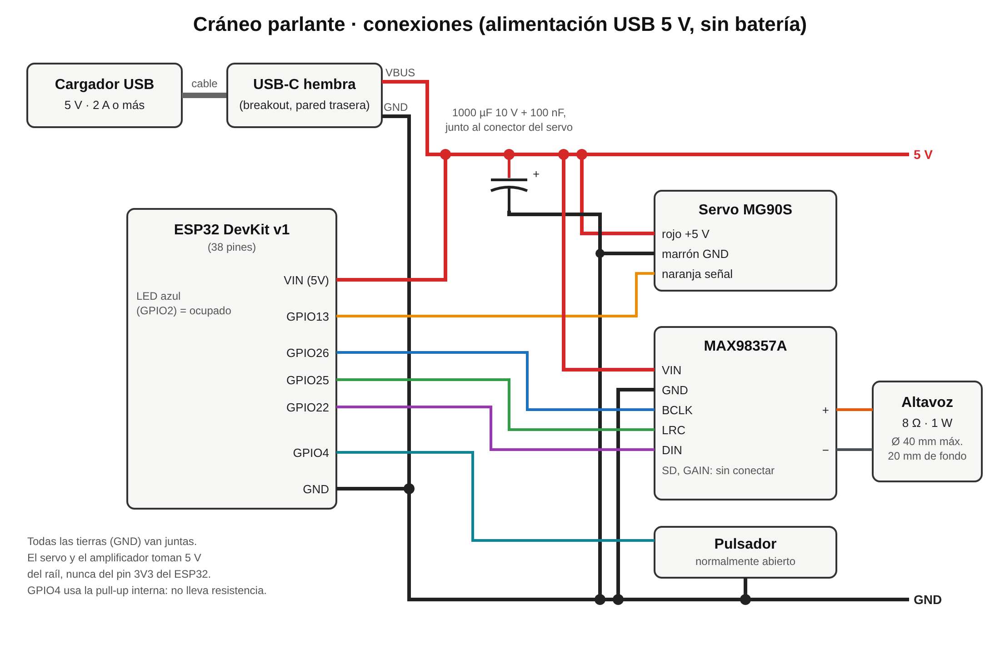

# Conexiones del cráneo parlante

El cráneo se alimenta siempre de un cargador USB de 5 V conectado a la pared. **No lleva batería**: la 18650, su portapilas, el módulo de carga IP5306 y el interruptor de la lista anterior ya no hacen falta (el orificio del interruptor del pedestal queda libre; se puede tapar o usar para el pulsador).

## Tabla de pines

| ESP32 DevKit v1 | Va a | Notas |
|---|---|---|
| VIN (5V) | Raíl de 5 V | El ESP32 se alimenta del mismo raíl, no por su micro-USB |
| GND | Raíl de GND | Todas las tierras juntas |
| GPIO13 | Servo MG90S, cable naranja (señal) | |
| GPIO26 | MAX98357A BCLK | |
| GPIO25 | MAX98357A LRC | |
| GPIO22 | MAX98357A DIN | |
| GPIO4 | Pulsador (la otra pata a GND) | Pull-up interna, sin resistencia |
| GPIO2 | LED azul de la placa | Encendido mientras piensa y habla; parpadea si hay error |

| Otro componente | Pin | Va a |
|---|---|---|
| USB-C hembra (breakout) | VBUS | Raíl de 5 V |
| | GND | Raíl de GND |
| Servo MG90S | Rojo | Raíl de 5 V |
| | Marrón | Raíl de GND |
| MAX98357A | VIN | Raíl de 5 V |
| | GND | Raíl de GND |
| | SD, GAIN | Sin conectar (mezcla mono, ganancia 9 dB) |
| | + / − | Altavoz 8 Ω |
| Condensador 1000 µF 10 V | + / − | 5 V / GND, junto al conector del servo |
| Condensador 100 nF | | En paralelo con el de 1000 µF |

## Alimentación

- Cargador USB de **5 V y al menos 2 A**. Cuando el servo arranca y el amplificador suena fuerte a la vez, el consumo puede pasar de 1 A por momentos.
- El USB-C hembra debe ser un breakout con las resistencias de 5,1 kΩ en CC1/CC2 (los que dicen «5.1k» o «para alimentación»); sin ellas, un cargador USB-C a USB-C no entrega corriente.
- El servo y el amplificador toman 5 V del raíl, **nunca** del pin 3V3 del ESP32.
- El condensador de 1000 µF (más uno de 100 nF) evita que los picos del servo reinicien el ESP32. Respeta la polaridad: la banda del condensador es el negativo.
- **Para programar el ESP32 por su micro-USB, desconecta antes el cargador del USB-C del pedestal.** Con los dos conectados, los 5 V del ordenador y del cargador quedan unidos.
- Cables del raíl de 5 V y GND: 22 AWG o más gruesos; para las señales basta con cable dupont.

## Altavoz

El de 8 Ω y 1 W sirve. El MAX98357A a 5 V puede dar más de 1 W a 8 Ω, por eso el firmware limita el volumen al 50 % (`VOLUME` en `firmware/include/config.h`); súbelo poco a poco si suena bajo.

**Comprueba el diámetro:** el aro de la tapa inferior del pedestal mide 41 mm por dentro (altavoz de 40 mm y hasta 20 mm de fondo). Si el tuyo es más grande, avisa para agrandar el aro (`spk_d` en `params.scad`).
